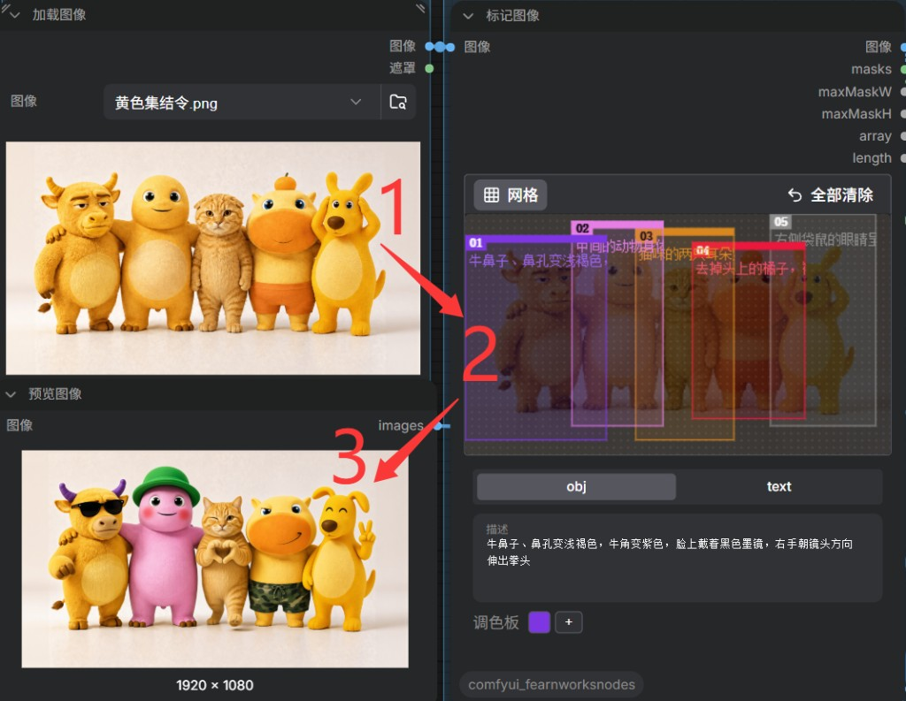

# ComfyUI-MarkImage

给单图画上不同的画框，并给每个框写上对应的重绘提示词，之后程序会以框作为基准，使用qwen image2.1逐块重绘，再贴回原图，得到最终结果。

## 更新日志

- 2026.11.9：优化偏色和布局偏移问题，新增局部高清节点

## 背景

目前开源的图片编辑模型中，Qwen Image 2.1 的出图效果比较强。但官方工作流是对整张图进行重绘，越高清的图修图速度越慢，而且只依靠提示词来修改整张图，也很容易改错地方。

这个节点包把「画框、局部裁切、局部高清、对齐 Qwen 尺寸、校色、贴回」整合在一起，能对单图完成多次局部重绘，最大程度保证不偏移、不偏色。



图中 1 是原图，2 是在「标记图像」里为每个角色画框并填写提示词，3 是全部框循环编辑后的结果。

## 安装

需要较新的 ComfyUI。画框用前端的 Bounding Box 编辑器（你可能需要开启ComfyUI左侧栏的"Nodes 2.0"的开关），示例工作流使用内置的 Loop、String Format、Seed，以及 Qwen Image 2.1 子图，在 ComfyUI 0.44 上保存。

```bash
cd ComfyUI/custom_nodes
git clone https://github.com/nianxi/ComfyUI-MarkImage.git
```

重启 ComfyUI。本仓库没有额外的 Python 依赖，校色和放大模型用的是 ComfyUI 已有的 `scipy`、`spandrel`。

节点包自带高清放大模型 `models/realesr-general-x4v3.pth`，约 4.7MB。下拉列表里也会出现 `models/upscale_models` 中的其他的放大模型，你可以自由使用喜欢的模型。

当前示例：[workflow/qwen2.1单图多次重绘.json](workflow/qwen2.1单图多次重绘.json)

## 节点

### 标记图像（`MarkImage`）

把原图接到 **图像**。在画布上拖出矩形，点选某一框，在 **描述** 里写这一块要执行的操作。`text` 用来填写需要出现在画面里的文字。接入图像后，画布宽高会按原图像素对齐。

| 输出 | 说明 |
| --- | --- |
| 图像 | 带彩色描边的图。描边宽 6 像素，画在框的外侧 |
| masks | 每个框一张遮罩，尺寸与原图相同，并向外扩展 12 像素，把描边包含在内 |
| maxMaskW / maxMaskH | 所有遮罩中的最大宽度、最大高度 |
| array | 每个框的 `id`、`x`、`y`、`width`、`height`、`desc`、`text`、`color` |
| length | 框的数量，用来设定循环次数 |

### 标记图像-子项（`MarkImageGetBox`）

按索引从 `array` 里取出一个框。把「标记图像」的 `masks` 也接上，就会按同一个索引输出对应遮罩。循环里的 `iteration_index` 接到 `index`。

输出：`color`、`desc`、`id`、`x`、`y`、`width`、`height`、`text`、`mask`。

### 标记图像-遮罩裁切（`MarkImageMaskCrop`）

按当前遮罩的外接矩形从原图切出一块。只切片，不缩放。

| 输入 | 说明 |
| --- | --- |
| 遮罩扩展倍数 | 1 到 2，一位小数，默认 1。以遮罩中心为基准，宽高同时乘这个倍数。1 表示不放大 |
| 遮罩扩展像素 | 倍数之后，四边再各加这么多像素。默认 32 |

超出画面的部分会裁掉。输出裁切图、对应遮罩，以及夹紧后的 `x`、`y`、`width`、`height`，供贴回使用。

### 标记图像-短边高清（`MarkImageUpscaleMinSide`）

裁切块的短边小于 **最小边长** 时，用放大模型拉到这个边长，长边按比例取整。短边已经达到或超过该值时，原样通过，不加载模型。默认最小边长 576，默认模型 `realesr-general-x4v3.pth`。示例工作流里最小边长是 640。

### 标记图像 Qwen 裁切（`MarkImageQwenCut`）

把图像收到 Qwen-Image 2.1 在当前分辨率下的不动点尺寸，宽高都是 32 的倍数。

| 输入 | 说明 |
| --- | --- |
| resolution | `default` 按输入面积对齐到 512–2048 之间的 32 倍数，也可以手动指定 |
| tol_ratio | 允许面积偏离 `resolution²` 的比例。越小越接近该档位的标准面积。示例为 0.8 |
| mode | `crop` 覆盖后中心裁切，`pad` 内嵌补边，`stretch` 直接拉伸。示例为 `stretch` |
| pad_color | 只在 `pad` 时使用 |

输出图像，以及对齐后的宽、高和所用分辨率。

### 标记图像-校色（`MarkImageColorCalibrator`）

对照编辑前的画面，校正模型带来的整体偏色和对比度。改动很大的区域不参与估计。两张图尺寸不一致时，会把原图缩到编辑图的尺寸再比较。

示例工作流中的取值：threshold 0.08，expand 64，open_k 13，close_k 51，strength 1，outside_mode `edited`，feather 24。

偏色节点的实现逻辑借鉴了 [https://github.com/zhoutingxi/ComfyUI-BlueBox](https://github.com/zhoutingxi/ComfyUI-BlueBox) ，感谢作者的开源方案~


### 标记图像-贴回（`MarkImagePasteCrop`）

把编辑结果缩回裁切时的宽高，按 `x`、`y` 贴回整图。**遮罩混合像素** 默认 32：遮罩先向外扩这么多像素，再按一半宽度做过渡。0 是硬边。标记以外的像素保持原图。示例工作流里这个值是 36。

### 其他

- **标记图像列表转批次**（`MarkImageToBatch`）：把循环积累的图像列表拼成一个批次。当前示例是在循环里逐张贴回，不用这个节点。
- **标记图像边缘校色**（`MarkImageBorderColor`）：只根据四周几乎没被改动的像素估计轻微偏色。当前示例使用的是上面的「标记图像-校色」。

## 局部编辑怎么接

每一轮只处理一个框。上一轮贴好的整图进入下一轮。

1. 「标记图像」输出遮罩、描述和框的数量。
2. `length` 接到 Start Loop 的 `max_iteration`。For 模式的上界不包含这个值，5 个框会依次使用索引 0 到 4。
3. 「标记图像-子项」按当前索引取出这一框的描述和遮罩。描述作为这一轮的编辑提示词。
4. 「标记图像-遮罩裁切」从循环中的整图切出这块像素。示例里扩展倍数是 1，四边再加 36 像素。
5. 「标记图像-短边高清」在短边不足时放大。示例最小边长 640。
6. 「标记图像 Qwen 裁切」对齐到 Qwen 能接受的尺寸，并把宽、高送给采样。
7. Qwen 的输出先缩回裁切时的宽高，再经过「标记图像-校色」。
8. 「标记图像-贴回」盖回整图。底图是循环里的当前整图，位置用裁切节点输出的坐标。
9. 全部框处理完后保存，并可与原图对比。

示例工作流使用 Qwen Image 2.1 Turbo。模型可以到这些地址下载。

魔搭 [Comfy-Org/Qwen-Image-2.1](https://www.modelscope.cn/models/Comfy-Org/Qwen-Image-2.1)：

- 主模型：[qwen_image_2.1_turbo_int8_convrot.safetensors](https://www.modelscope.cn/models/Comfy-Org/Qwen-Image-2.1/file/view/master/diffusion_models%2Fqwen_image_2.1_turbo_int8_convrot.safetensors)
- 编码器：[qwen3vl_8b_int8_convrot.safetensors](https://www.modelscope.cn/models/Comfy-Org/Qwen-Image-2.1/file/view/master/text_encoders%2Fqwen3vl_8b_int8_convrot.safetensors) 或 [qwen3vl_8b_w4a8.safetensors](https://www.modelscope.cn/models/Comfy-Org/Qwen-Image-2.1/file/view/master/text_encoders%2Fqwen3vl_8b_w4a8.safetensors)
- VAE：[qwen_image_2.1_vae_bf16.safetensors](https://www.modelscope.cn/models/Comfy-Org/Qwen-Image-2.1/file/view/master/vae%2Fqwen_image_2.1_vae_bf16.safetensors)

Hugging Face [Comfy-Org/Qwen-Image-2.1](https://huggingface.co/Comfy-Org/Qwen-Image-2.1)：

- 主模型：[qwen_image_2.1_turbo_int8_convrot.safetensors](https://huggingface.co/Comfy-Org/Qwen-Image-2.1/blob/main/diffusion_models/qwen_image_2.1_turbo_int8_convrot.safetensors)
- 编码器：[qwen3vl_8b_int8_convrot.safetensors](https://huggingface.co/Comfy-Org/Qwen-Image-2.1/blob/main/text_encoders/qwen3vl_8b_int8_convrot.safetensors) 或 [qwen3vl_8b_w4a8.safetensors](https://huggingface.co/Comfy-Org/Qwen-Image-2.1/blob/main/text_encoders/qwen3vl_8b_w4a8.safetensors)
- VAE：[qwen_image_2.1_vae_bf16.safetensors](https://huggingface.co/Comfy-Org/Qwen-Image-2.1/blob/main/vae/qwen_image_2.1_vae_bf16.safetensors)

## 描述怎么写

一个框只写这一块的事，写清要改的部位和改成什么样。预览图里的五条指令是：

- 牛鼻子、鼻孔变浅褐色，牛角变紫色，脸上戴着黑色墨镜，右手朝镜头方向伸出拳头；
- 中间的动物身体变粉色，加上腮红，头上戴着绿帽子；
- 猫咪的两只耳朵竖起来，一只眼睛在 wink，双手比出爱心；
- 去掉头上的橘子，裤子变迷彩色的泳裤，露出轻蔑一笑；
- 右侧袋鼠的眼睛呈月牙形，左耳朵下垂，左手比出剪刀手；

框尽量贴住要改的对象。需要周围画面时，用遮罩扩展像素留出来，不必把框画得很大。


## 许可

[MIT](LICENSE)
