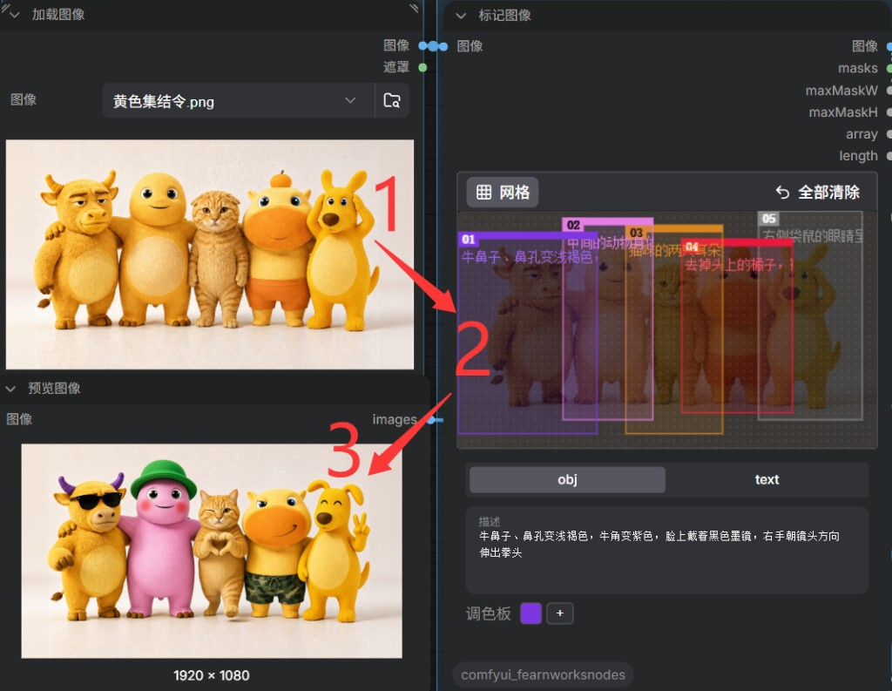

# ComfyUI-MarkImage

一、背景

在目前开源的图片编辑模型里面，大家普遍认为qwen image 2.1的出图效果是最强的。

但官流给的工作流是对整张图片做重绘，并且重绘的位置完全依赖提示词。因此执行效率略慢，如果是对2K/4K图做重绘，那就更慢了，此外，单纯依靠提示词对全图做编辑，在准确度上容易发生偏差。而在这方面，顶尖的闭源模型比如gpt image、nano banana则处理的更好。

因此，为了获得更高效、更精确的局部重绘效果，有必要对官流做一定优化处理。

二、想法

为达到优化工作流的目的，恰巧遇到了2个适合放在一起做配合的节点。

- 以前搭建过ACE工作流的朋友，应该很熟悉 [Inpaint-CropAndStitch](https://github.com/lquesada/ComfyUI-Inpaint-CropAndStitch) 里面的裁切+局部放大的节点；
- flux3 image官流里面有个"创建边界框"的节点，在comfyUI的左侧栏开启node2.0后就能使用，它可以给当前图片绘制遮罩、输入对应的提示词，体验上很不错；

但是，"创建边界框”节点无法与"CropAndStitch"节点很好的融合，因此，让AI编写了当前这个项目节点「标记图像」。以便让两者相互配合，共同优化qwen image 2.1的图片编辑工作流。

以下这张图是本次工作流跑出来的，很多人看到的第一反应是觉得眼前一亮。



图中1是原图，**2**是在「标记图像」中为每个角色进行画框和填写提示词，3是全部裁剪图在经过循环编辑后出的结果。

## 功能

- 在节点画布上直接拖拽画框，框会随工作流保存。
- 每个框可自行分配颜色，方便视觉上做区分。
- 每个框单独输出一张与裁剪图相同尺寸的遮罩，坐标、描述和颜色。
- 给出全部遮罩的最大宽高，用来决定裁剪后要放大到多大。


## 安装

需要较新的 ComfyUI：画框依赖前端的 Bounding Box 编辑器。

示例工作流在 ComfyUI 0.41 上保存，并使用了内置的 Loop 节点和 Qwen Image 2.1 节点。

```bash
cd ComfyUI/custom_nodes
git clone https://github.com/nianxi/ComfyUI-MarkImage.git
```

重启 ComfyUI。本仓库没有额外的 Python 依赖。

在节点菜单的 **image** 分类下可以找到「标记图像」。

## 节点


### 标记图像（`MarkImage`）

把原图接到 **图像**。在画布上拖出矩形，点选某一框，在 **描述** 里写这一块要执行的操作。`text` 用来填写需要出现在画面里的文字。接入图像后，画布宽高会按原图像素对齐。


| 输出                  | 说明                                                       |
| ------------------- | -------------------------------------------------------- |
| 图像                  | 带彩色描边的图。描边宽 6 像素，画在框的外侧                                  |
| masks               | 每个框一张遮罩，尺寸与原图相同，并向外扩展 12 像素，把描边包含在内                      |
| maxMaskW / maxMaskH | 所有遮罩中的最大宽度、最大高度                                          |
| array               | 每个框的 `id`、`x`、`y`、`width`、`height`、`desc`、`text`、`color` |
| length              | 框的数量，用来设定循环次数                                            |


### 标记图像子项（`MarkImageGetBox`）

按索引从 `array` 里取出一个框。把「标记图像」的 `masks` 也接上，就会按同一个索引输出对应遮罩。循环里的 `iteration_index` 接到 `index`。

输出：`color`、`desc`、`id`、`x`、`y`、`width`、`height`、`text`、`mask`。

### 标记图像列表转批次（`MarkImageToBatch`）

把循环结束时积累的图像列表拼成一个批次，供 Inpaint Stitch 一次缝回。示例工作流是在循环内部逐张缝回的。

### 标记图像边缘校色（`MarkImageBorderColor`）

对照裁剪前的原图，估计编辑模型带来的整体色偏，再加回编辑结果。取样只发生在边缘，并且会跳过差异已经很大的像素；接上裁剪遮罩后，正在修改的区域也不会参与估计。


| 输入   | 说明                               |
| ---- | -------------------------------- |
| 编辑图  | Image Edit 输出的裁剪结果               |
| 裁剪图  | Inpaint Crop 输出的裁剪原图             |
| 裁剪遮罩 | 可选。接 Inpaint Crop 的 cropped mask |
| 边缘宽度 | 默认 32                            |
| 强度   | 默认 1，范围 0 到 1                    |


## 局部编辑怎么接

示例工作流：[workflow/qwen2.1局部重绘.json](workflow/qwen2.1局部重绘.json)

每一轮只处理一个框，上一轮缝好的整图会进入下一轮：

1. 「标记图像」输出遮罩、描述和框的数量。
2. `length` 接到 Start Loop 的 `max_iteration`。For 模式的上界不包含这个值，5 个框会依次使用索引 0 到 4。
3. 「标记图像子项」按当前索引取出这一框的描述和遮罩。
4. Inpaint Crop 按遮罩裁剪，并向外多取一块上下文（示例里上下文扩展系数为 1.5，遮罩扩展 32 像素）。裁剪结果会放大：边长取「遮罩最大边」和「最小边长 576」里更大的那个，再限制在最大边长 2176 以内，最后对齐到 32 的倍数。框越小，放大越明显，模型越容易看清要改的细节。
5. 该框的描述作为 Qwen Image 2.1 Turbo 这一轮的编辑提示词。
6. 「标记图像边缘校色」对照裁剪原图，去掉轻微偏色。
7. Inpaint Stitch 把这一块贴回整图，作为下一轮的输入。
8. 全部框处理完后保存，并可与原图对比。

加载示例前，还需要这些自定义节点：

- [ComfyUI-Inpaint-CropAndStitch](https://github.com/lquesada/ComfyUI-Inpaint-CropAndStitch)：裁剪与缝回
- [ComfyUI_essentials](https://github.com/cubiq/ComfyUI_essentials)：`SimpleMath+`
- [ComfyUI-KJNodes](https://github.com/kijai/ComfyUI-KJNodes)：`INT Constant`
- [ComfyUI-Apt_Preset](https://github.com/cardenluo/ComfyUI-Apt_Preset)：`math_calculate`，用来计算裁剪边长

示例工作流使用 Qwen Image 2.1 Turbo，以下是模型下载的官方地址：

魔搭 [Comfy-Org/Qwen-Image-2.1](https://www.modelscope.cn/models/Comfy-Org/Qwen-Image-2.1)：

- 主模型：[qwen_image_2.1_turbo_int8_convrot.safetensors](https://www.modelscope.cn/models/Comfy-Org/Qwen-Image-2.1/file/view/master/diffusion_models%2Fqwen_image_2.1_turbo_int8_convrot.safetensors)
- 编码器：[qwen3vl_8b_int8_convrot.safetensors](https://www.modelscope.cn/models/Comfy-Org/Qwen-Image-2.1/file/view/master/text_encoders%2Fqwen3vl_8b_int8_convrot.safetensors) 或 [qwen3vl_8b_w4a8.safetensors](https://www.modelscope.cn/models/Comfy-Org/Qwen-Image-2.1/file/view/master/text_encoders%2Fqwen3vl_8b_w4a8.safetensors)
- VAE：[qwen_image_2.1_vae_bf16.safetensors](https://www.modelscope.cn/models/Comfy-Org/Qwen-Image-2.1/file/view/master/vae%2Fqwen_image_2.1_vae_bf16.safetensors)

Hugging Face [Comfy-Org/Qwen-Image-2.1](https://huggingface.co/Comfy-Org/Qwen-Image-2.1)：

- 主模型：[qwen_image_2.1_turbo_int8_convrot.safetensors](https://huggingface.co/Comfy-Org/Qwen-Image-2.1/blob/main/diffusion_models/qwen_image_2.1_turbo_int8_convrot.safetensors)
- 编码器：[qwen3vl_8b_int8_convrot.safetensors](https://huggingface.co/Comfy-Org/Qwen-Image-2.1/blob/main/text_encoders/qwen3vl_8b_int8_convrot.safetensors) 或 [qwen3vl_8b_w4a8.safetensors](https://huggingface.co/Comfy-Org/Qwen-Image-2.1/blob/main/text_encoders/qwen3vl_8b_w4a8.safetensors)
- VAE：[qwen_image_2.1_vae_bf16.safetensors](https://huggingface.co/Comfy-Org/Qwen-Image-2.1/blob/main/vae/qwen_image_2.1_vae_bf16.safetensors)


## 描述怎么写

一个框只写这一块的事，写清要改的部位和改成什么样。示例工作流里的五条指令是：

- 牛鼻子、鼻孔变浅褐色，牛角变紫色，脸上戴着黑色墨镜，右手朝镜头方向伸出拳头；
- 中间的动物身体变粉色，加上腮红，头上戴着绿帽子；
- 猫咪的两只耳朵竖起来，一只眼睛在 wink，双手比出爱心；
- 去掉头上的橘子，裤子变迷彩色的泳裤，露出轻蔑一笑；
- 右侧袋鼠的眼睛呈月牙形，左耳朵下垂，左手比出剪刀手；

框尽量贴住要改的对象，并留出一点周围画面，裁剪放大后模型才有足够的上下文。

## 许可

[MIT](LICENSE)